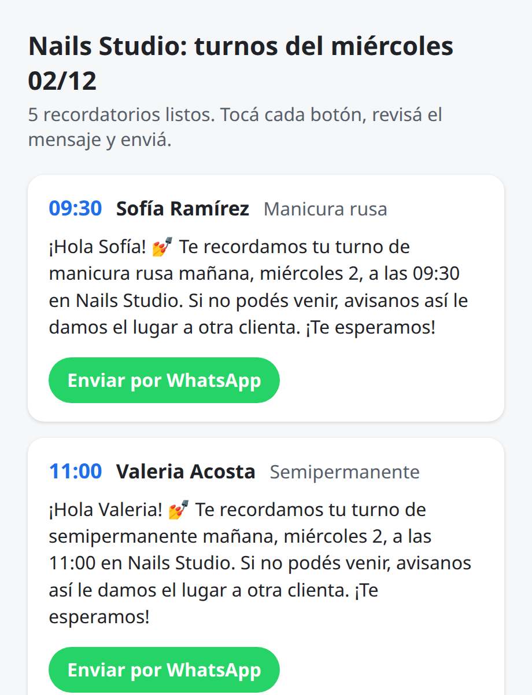

# Appointment reminders

Salons and small service businesses lose hours when a client forgets an appointment. This tool reads the agenda the business already keeps and prepares a friendly WhatsApp reminder for each client of the next day, ready to send with one tap.



## How it works

1. Export the agenda as CSV with the columns `date, time, client, phone, service` (see [`sample_data/agenda.csv`](sample_data/agenda.csv)).
2. Run the script. It keeps only the appointments of the chosen day (tomorrow by default) and fills a message template with each client's name, service and time.
3. Open `output/reminders_<date>.html`. Each card has a **Send on WhatsApp** button: a `wa.me` link with the message already written. The person reviews it and taps Send.

No WhatsApp API, no bots, no external services: everything stays on the computer. Python standard library only.

## Usage

```bash
python3 remind.py sample_data/agenda.csv --date 2026-12-02 --business "Nails Studio"
```

Options:

- `--date YYYY-MM-DD` day to remind (default: tomorrow)
- `--business` business name used in the message
- `--template` custom message with `{first_name}`, `{service}`, `{weekday}`, `{day}`, `{time}`, `{business}`
- `--out` output folder (default: `output/`)

The messages are in Spanish because the tool is used by businesses in Argentina.
