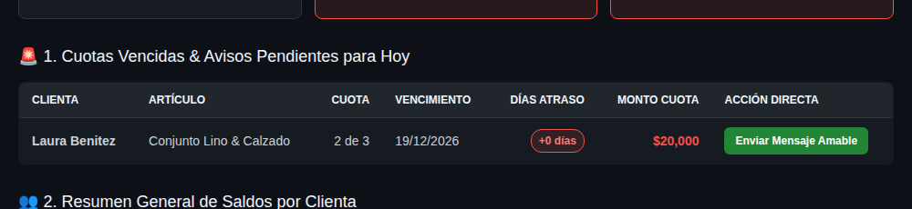

# Customer Credit & Installments Tracker

Small clothing shops and neighborhood businesses often sell on store credit or installment plans without formal finance systems. The real challenge comes when balances are kept in a notebook or in memory, leading to forgotten overdue dates or awkward collection chats. This tool maintains clean credit accounts from two simple CSV tables, flags overdue installments, and generates cordial WhatsApp reminder links ready to send with one tap.



## How it works

1. Log installment sales in `sales.csv` (`sale_id, date, client, phone, item, total_amount, installments_count`) (see [`sample_data/sales.csv`](sample_data/sales.csv)).
2. Record payments as they arrive in `payments.csv` (`payment_id, sale_id, payment_date, amount_paid`) (see [`sample_data/payments.csv`](sample_data/payments.csv)).
3. Run `track_installments.py`. It:
   - Calculates exact client balances dynamically (never hardcoded).
   - Identifies which installments are due or overdue as of today.
   - Calculates days late.
   - Generates a respectful, friendly WhatsApp message template with a direct `wa.me` link so you can follow up with one tap.

## Usage

```bash
python3 track_installments.py sample_data/sales.csv --payments sample_data/payments.csv --business "Modas Elegance" --as-of 2026-12-19 --out output/
```

Options:
- `sales_csv` path to the sales log.
- `--payments` path to the payments log.
- `--business` name of your shop.
- `--as-of` reference date for aging (default: today).
- `--out` output folder (default: `output/`).

Built by [Javier Velazquez](https://github.com/the-heimdallr) · MIT License
