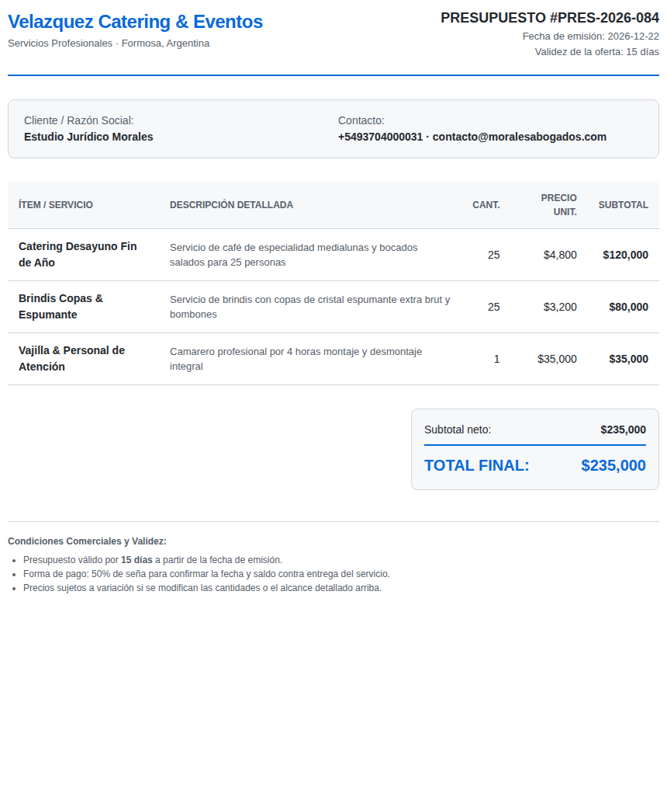

# Professional PDF Quotes & Proposals

Service businesses (catering, tailoring, photography, design) often send quotes as informal chat messages where prices get lost or look unprofessional. This tool takes line items from a spreadsheet and turns them into a clean, print-ready PDF proposal featuring business branding, itemized pricing, subtotal, total, and clear validity terms.



## How it works

1. Fill out quote items in `quotes.csv` (`quote_id, date, client, phone, email, item, description, quantity, unit_price`) (see [`sample_data/quotes.csv`](sample_data/quotes.csv)).
2. Run `generate_quote.py`. It:
   - Formats quantities, unit prices, and subtotals.
   - Calculates the final total and commercial conditions.
   - Compiles a clean A4 PDF via headless browser (zero complex C libraries or broken layouts).
3. The resulting PDF is stored in `output/presupuestos/<quote_id>.pdf`, ready to attach to an email or send via WhatsApp.

## Usage

```bash
python3 generate_quote.py sample_data/quotes.csv --business "Velazquez Catering & Eventos" --validity "15 días" --out output/presupuestos/
```

Options:
- `csv_path` path to the quote items CSV.
- `--business` name of your company or studio.
- `--validity` proposal validity window (e.g., "15 días").
- `--out` output directory for generated PDFs.

Built by [Javier Velazquez](https://github.com/the-heimdallr) · MIT License
