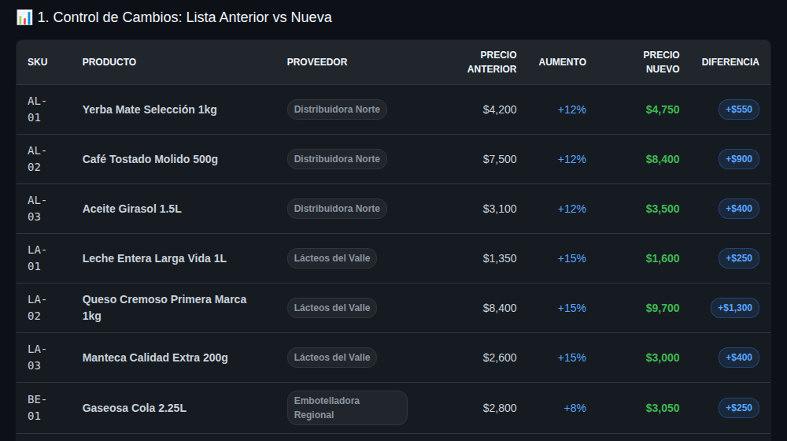

# Batch Price List Updater

In high-inflation environments or frequent supplier re-pricing, updating hundreds of items by hand in a spreadsheet leads to delayed increases or missed products that bleed profits. This tool applies percentage updates in batch by supplier or category, performs clean commercial retail rounding, and provides an audit difference table before generating customer-ready price lists.



## How it works

1. Keep your master product list in `products.csv` with columns: `sku, product, category, supplier, old_price` (see [`sample_data/products.csv`](sample_data/products.csv)).
2. Maintain percentage increases in `rules.csv` by supplier or category (see [`sample_data/rules.csv`](sample_data/rules.csv)).
3. Run `update_prices.py`. It:
   - Matches products against supplier/category increase rules.
   - Applies clean commercial rounding to the nearest 50.
   - Produces a side-by-side audit report comparing old and new prices with exact differences.
   - Generates a clean customer-facing price list ready to share via WhatsApp or print.

## Usage

```bash
python3 update_prices.py sample_data/products.csv --rules sample_data/rules.csv --business "Almacén Central" --out output/
```

Options:
- `products_csv` path to product list.
- `--rules` path to the rules file.
- `--business` name of your store.
- `--out` output folder (default: `output/`).

Built by [Javier Velazquez](https://github.com/the-heimdallr) · MIT License
