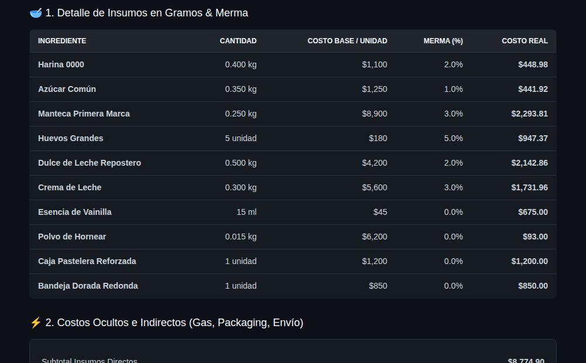

# Recipe Costing & Pricing Calculator

Small home bakeries, pastry chefs, and catering services often set menu prices by guessing or copying competitors without knowing their real food cost. This tool calculates unit product costs down to the gram, factors in ingredient waste (merma), adds hidden utility and packaging overheads, and calculates target selling prices along with delivery app pricing.



## How it works

1. Maintain an `ingredients.csv` table with unit costs and expected waste percentages (see [`sample_data/ingredients.csv`](sample_data/ingredients.csv)).
2. Write recipes in a simple `recipe.csv` with grams or unit quantities (see [`sample_data/recipe.csv`](sample_data/recipe.csv)).
3. Run `cost.py`. It computes:
   - Direct ingredient cost taking waste/loss into account.
   - Hidden indirect costs: oven gas/electricity per minute, cake box and board packaging, and delivery.
   - Target price for direct sales given your desired gross margin (e.g. 55%).
   - Delivery app price (e.g., Rappi, PedidosYa) to maintain your net profit margin after absorbing the platform's 25% commission.
4. Generates an easy-to-read HTML cost report ready to print or share.

## Usage

```bash
python3 cost.py sample_data/recipe.csv --ingredients sample_data/ingredients.csv --margin 0.55 --oven-min 45 --out output/
```

Options:
- `recipe_csv` path to the recipe CSV file.
- `--ingredients` path to the raw materials CSV database.
- `--margin` target gross margin as decimal (e.g., `0.55` for 55%).
- `--oven-min` baking time in minutes to calculate energy cost.
- `--out` output folder (default: `output/`).

Built by [Javier Velazquez](https://github.com/the-heimdallr) · MIT License
