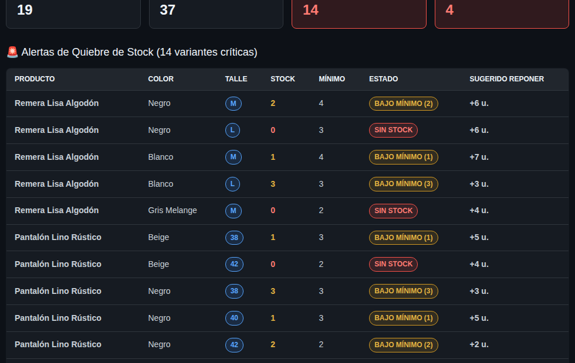

# Stock by size and color

Clothing shops and boutiques often run into the same problem: promising an item they thought was in stock, only to find the size or color was already sold. This tool manages inventory at the variant level (product, color, and size), flags items that fall below minimum thresholds, and prepares supplier replenishment orders ready to send via WhatsApp.



## How it works

1. Maintain your stock list as a CSV exported from Excel or Google Sheets with columns `supplier, product, color, size, stock, min_stock` (see [`sample_data/stock.csv`](sample_data/stock.csv)).
2. Run `stock.py`. It calculates current balances, spots variants running low or out of stock, and calculates safety replenishment quantities.
3. Open `output/stock_report.html` to see:
   - **Critical alerts:** variants in red (out of stock) or yellow (below minimum).
   - **Replenishment grouped by supplier:** each supplier has an **Enviar Pedido por WhatsApp** button with the formatted items ready to send with one tap (`wa.me` link).
   - **Full inventory table:** overview of all variants and statuses.

No external APIs, no cloud database, no monthly fees. Standard Python 3 only.

## Usage

```bash
python3 stock.py sample_data/stock.csv --business "Tienda Urbana" --out output/
```

Options:
- `csv_path` path to the CSV inventory file.
- `--business` name of your shop shown on the report.
- `--out` output folder (default: `output/`).

Built by [Javier Velazquez](https://github.com/the-heimdallr) · MIT License
