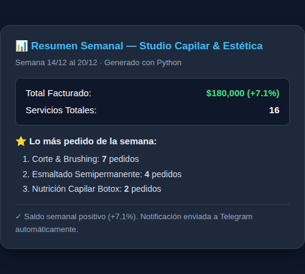

# Automated Weekly Sales Summary to Mobile

Small business owners don't need complex 20-chart dashboards to check on their business. They need to know, in 10 seconds from their phone, how the week went: total revenue, best-selling products, and whether sales grew or dropped compared to last week. This tool aggregates sales from a simple CSV spreadsheet and formats a clean weekly summary message ready to be delivered via Telegram.



## How it works

1. Log daily sales in `sales.csv` (`date, ticket_id, product, category, quantity, price_unit, payment_method`) (see [`sample_data/sales.csv`](sample_data/sales.csv)).
2. Run `summarize_sales.py`. It:
   - Aggregates weekly revenue and units sold.
   - Computes the top 3 best-selling products or services.
   - Calculates percentage growth compared to the previous week.
   - Formats a compact Telegram message and generates a web preview.
3. Schedule it weekly on Mondays using a simple systemd timer or GitHub Actions cron.

## Usage

```bash
python3 summarize_sales.py sample_data/sales.csv --business "Studio Capilar & Estética" --out output/
```

Options:
- `sales_csv` path to sales records CSV.
- `--business` name of your shop or service.
- `--out` output folder (default: `output/`).

Built by [Javier Velazquez](https://github.com/the-heimdallr) · MIT License
