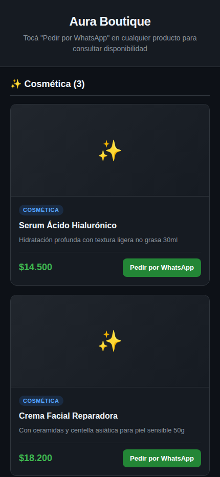

# Static WhatsApp Catalog

Many small fashion and cosmetics businesses sell directly through WhatsApp and spend hours answering questions like "how much is this?" or sending product photos one by one. This tool generates a clean, responsive static web catalog from a simple CSV spreadsheet, where each product has a direct **Pedir por WhatsApp** button with the order pre-filled.



## How it works

1. Fill out your product catalog in a CSV file with columns: `category, product, description, price, image` (see [`sample_data/catalog.csv`](sample_data/catalog.csv)).
2. Run `build_catalog.py`. It renders the HTML page with responsive product cards, category navigation and formatted Argentine Peso prices.
3. Each card has a direct link to `wa.me/<phone>?text=<encoded_order>`. When the customer taps the button, WhatsApp opens with the product name and price already written, ready to send.
4. Host it for free on Cloudflare Pages or GitHub Pages: zero backend server, zero database, zero monthly fees.

## Usage

```bash
python3 build_catalog.py sample_data/catalog.csv --business "Aura Boutique" --phone "+5493704000010" --out output/
```

Options:
- `csv_path` path to the CSV file.
- `--business` store name displayed on the header.
- `--phone` WhatsApp business phone number with country code.
- `--out` output folder (default: `output/`).

Built by [Javier Velazquez](https://github.com/the-heimdallr) · MIT License
